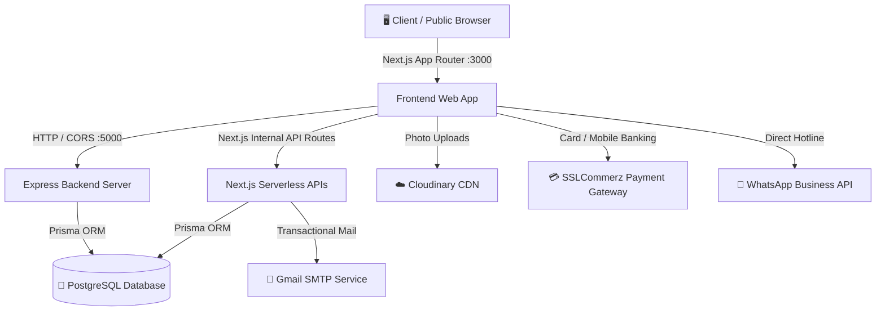

# 🌿 A R GREEN GARDEN — সম্পূর্ণ প্রোজেক্ট স্ট্রাকচার ও ফিচার গাইড (A to Z)

> **প্রোজেক্টের ধরন:** আধুনিক ল্যান্ডস্কেপ আর্কিটেকচার, ছাদবাগান, বৃক্ষ চিকিৎসা (Tree Doctor), ও পূর্ণাঙ্গ বিজনেস ম্যানেজমেন্ট সিস্টেম।  
> **টেকনোলজি স্ট্যাক:** Next.js 16 (App Router), React 19, TypeScript, Tailwind CSS v4, Node.js/Express, PostgreSQL, Prisma ORM, SSLCommerz, Cloudinary, Nodemailer।

---

## 📑 সূচিপত্র (Table of Contents)
1. [এক নজরে সম্পূর্ণ প্রোজেক্টের রূপরেখা](#1-এক-নজরে-সম্পূর্ণ-প্রোজেক্টের-রূপরেখা)
2. [সিস্টেম আর্কিটেকচার ডায়াগ্রাম](#2-সিস্টেম-আর্কিটেকচার-ডায়াগ্রাম)
3. [ফোল্ডার ও ফাইল স্ট্রাকচার (Folder Structure Explained)](#3-ফোল্ডার-ও-ফাইল-স্ট্রাকচার)
4. [ন্যাভবার থেকে ফুটার পর্যন্ত হোমপেজের প্রতিটি সেকশনের কাজ (A to Z)](#4-ন্যাভবার-থেকে-ফুটার-পর্যন্ত-হোমপেজ-ওয়াকথ্রু)
5. [মোট ফিচার তালিকা ও কীভাবে কাজ করে (All Features Explained)](#5-মোট-ফিচার-তালিকা-ও-কীভাবে-কাজ-করে)
6. [পোর্টাল ও রোল ভিত্তিক ড্যাশবোর্ডসমূহ (Role-Based Dashboards)](#6-পোর্টাল-ও-রোল-ভিত্তিক-ড্যাশবোর্ডসমূহ)
7. [ডাটাবেজ মডেল ও রিলেশন (Prisma & PostgreSQL)](#7-ডাটাবেজ-মডেল-ও-রিলেশন)
8. [এপিআই এন্ডপয়েন্ট ও সার্ভিসেস (APIs & Services)](#8-এপিআই-এন্ডপয়েন্ট-ও-সার্ভিসেস)
9. [পেমেন্ট ও এক্সটার্নাল ইন্টিগ্রেশন (Integrations)](#9-পেমেন্ট-ও-এক্সটার্নাল-ইন্টিগ্রেশন)
10. [রান ও টেস্টিং নির্দেশিকা (How to Run & Test)](#10-রান-ও-টেস্টিং-নির্দেশিকা)

---

## 1. এক নজরে সম্পূর্ণ প্রোজেক্টের রূপরেখা
**A R Green Garden** হলো বাংলাদেশের প্রথম আন্তর্জাতিক মানের আর্কিটেকচারাল স্টুডিও-থিম ভিত্তিক ল্যান্ডস্কেপ ও ছাদবাগান প্ল্যাটফর্ম। এটি শুধু একটি স্ট্যাটিক শোকেস ওয়েবসাইট নয়; বরং ক্লায়েন্ট লিড কালেকশন, ৩ডি ইন্টারেক্টিভ গার্ডেন উইজার্ড, জরুরি বৃক্ষ চিকিৎসা (Tree Doctor Call-out), এমপ্লয়ি উপস্থিতি ও প্রজেক্ট অ্যাসাইনমেন্ট, স্বয়ংক্রিয় কোটেশন-ইনভয়েস বিল্ডার, এবং ডিজিটাল সার্ভিস কার্ড (Digital Service Card with QR) সমন্বিত একটি সেন্ট্রালাইজড এন্টারপ্রাইজ সফটওয়্যার।

---

## 2. সিস্টেম আর্কিটেকচার ডায়াগ্রাম



---

## 3. ফোল্ডার ও ফাইল স্ট্রাকচার

প্রোজেক্টটি দুটি প্রধান মডিউলে বিভক্ত:
1. `green-garden` — Next.js 16 ফ্রন্টএন্ড এবং ফুল-স্ট্যাক ক্লায়েন্ট পোর্টাল।
2. `green-garden-server` — ডেডিকেটেড Express.js ব্যাকএন্ড এপিআই সার্ভার।

### 📂 ফ্রন্টএন্ড ফোল্ডার ডিরেক্টরি (`green-garden/`)
```
green-garden/
├── prisma/
│   ├── schema.prisma             # PostgreSQL রিলেশনাল ডাটাবেজ মডেল ও স্কিমা
│   └── seed.ts                   # অ্যাডমিন, সার্ভিস, প্রজেক্ট, ইনভেন্টরি ডেমো সিডার
├── public/                       # স্ট্যাটিক ছবি, ভিডিও, লোগো এবং আইকন
├── src/
│   ├── app/                      # Next.js App Router রুটসমূহ
│   │   ├── (auth)/               # অথেনটিকেশন পেজসমূহ
│   │   │   ├── login/page.tsx           # রোল-ভিত্তিক লগইন (Admin, Client, Employee)
│   │   │   ├── register/page.tsx        # নতুন ক্লায়েন্ট রেজিস্ট্রেশন
│   │   │   └── forgot-password/page.tsx # পাসওয়ার্ড পুনরুদ্ধার
│   │   ├── (public)/             # সর্বসাধারণের জন্য উন্মুক্ত পেজ
│   │   │   ├── layout.tsx               # পাবলিক লেআউট (Navbar + Footer + Floating Doctor + Modal)
│   │   │   ├── page.tsx                 # মূল হোমপেজ (৮টি আর্কিটেকচারাল সেকশন)
│   │   │   ├── services/                # ৭টি প্রধান ক্যাটাগরির সার্ভিস ক্যাটালগ
│   │   │   │   └── [slug]/page.tsx      # ডাইনামিক সার্ভিস বিস্তারিত ও বুকিং
│   │   │   ├── gallery/page.tsx         # ১৭টি ফিল্টার সমন্বিত প্রজেক্ট গ্যালারি
│   │   │   ├── before-after/page.tsx    # বিফোর/আফটার ট্রান্সফরমেশন স্লাইডার
│   │   │   ├── tree-doctor/page.tsx     # জরুরি বৃক্ষ ক্লিনিক ও অন-কল ডাক্তার বুকিং
│   │   │   ├── design-garden/page.tsx   # ৩ডি গার্ডেন ক্যালকুলেটর ও ডিজাইন উইজার্ড
│   │   │   ├── team/page.tsx            # বিশেষজ্ঞ টিম ও আর্কিটেক্ট পরিচিতি
│   │   │   └── contact/page.tsx         # অফিস লোকেশন, গুগল ম্যাপ ও কন্টাক্ট ফর্ম
│   │   ├── admin/page.tsx        # অ্যাডমিন মাস্টার কন্ট্রোল সেন্টার (১৫টি ট্যাব)
│   │   ├── client-dashboard/     # ক্লায়েন্ট পোর্টাল (প্রজেক্ট ট্র্যাকিং, ইনভয়েস, পেমেন্ট)
│   │   ├── employee-portal/      # এমপ্লয়ি পোর্টাল (দৈনিক কাজ, হাজিরা, শিডিউল)
│   │   ├── moderator/page.tsx    # মডারেটর ড্যাশবোর্ড (রিভিউ ও রিকোয়েস্ট ফিল্টারিং)
│   │   ├── ai-tools/page.tsx     # এআই ল্যান্ডস্কেপ কস্ট ও প্ল্যান্ট কনসালট্যান্ট
│   │   ├── not-found.tsx         # কাস্টম ৪MD আর্কিটেকচারাল নট-ফাউন্ড পেজ
│   │   ├── globals.css           # গ্লোবাল সিএসএস ও টাইপোগ্রাফি
│   │   └── api/                  # Next.js ফুলস্ট্যাক API রাউটসমূহ
│   │       ├── auth/             # লগইন, রেজিস্ট্রেশন, সেশন ভেরিফিকেশন
│   │       ├── projects/         # প্রজেক্ট CRUD ও প্রোগ্রেস আপডেট
│   │       ├── services/         # সার্ভিসেস ডাটা ফেচিং
│   │       ├── quotations/       # স্মার্ট কোটেশন ক্যালকুলেশন ও জেনারেশন
│   │       ├── maintenance/      # মেইনটেন্যান্স শিডিউলার এপিআই
│   │       ├── tree-doctor/      # ট্রি ডক্টর রিকোয়েস্ট প্রসেসিং
│   │       ├── attendance/       # এমপ্লয়ি চেক-ইন ও চেক-আউট
│   │       ├── payments/         # SSLCommerz পেমেন্ট ইনিশিয়ালাইজ ও কলব্যাক
│   │       ├── design-requests/  # ডিজাইন উইজার্ড ফর্ম সাবমিশন
│   │       ├── upload/           # Cloudinary সিকিউর ইমেজ আপলোড
│   │       └── settings/         # ওয়েবসাইট ডাইনামিক কনফিগারেশন
│   ├── components/               # রিইউজেবল রিয়্যাক্ট কম্পোনেন্টস
│   │   ├── layout/               # Navbar.tsx ও Footer.tsx
│   │   ├── home/                 # ShmaHeroVideo, ShmaAnimatedManifesto, ShmaHighlightProjects,
│   │   │                         # ShmaServicesFlip, ShmaProcess, ShmaCampaign, ShmaLife, Estimator
│   │   ├── admin/                # OverviewTab, ProjectsTab, FinanceInventoryTab, etc.
│   │   ├── shared/               # EmergencyTreeDoctorModal.tsx
│   │   └── WeatherPlantCareWidget.tsx # আবহাওয়া অনুযায়ী প্ল্যান্ট কেয়ার উইজেট
│   ├── context/                  # গ্লোবাল স্টেট ম্যানেজমেন্ট
│   │   ├── AuthContext.tsx       # ইউজার লগইন সেশন ও রোল কন্ট্রোল
│   │   └── LanguageContext.tsx   # বাংলা / ইংরেজি দ্বিভাষিক ট্রান্সলেশন ইঞ্জিন
│   ├── lib/                      # ইউটিলিটি ও ক্লায়েন্ট লাইব্রেরিসমূহ
│   │   ├── prisma.ts             # Prisma Client সিঙ্গেলটন ইনস্ট্যান্স
│   │   ├── cloudinary.ts         # ক্লাউডিনারি ফাইল আপলোড হ্যান্ডলার
│   │   ├── email.ts              # নোডমেইলার জিমেইল এসএমটিপি ইমেইল অ্যালার্ট
│   │   └── sslcommerz.ts         # SSLCommerz পেমেন্ট গেটওয়ে কনফিগারেশন
│   └── services/                 # ডেডিকেটেড বিজনেস লজিক
│       ├── invoiceGenerator.ts   # প্রফেশনাল ইনভয়েস ও রসিদ জেনারেটর
│       └── whatsapp.ts           # ওয়ান-ক্লিক হোয়াটসঅ্যাপ ইন্টিগ্রেশন
```

### 📂 ব্যাকএন্ড এক্সপ্রেস সার্ভার (`green-garden-server/`)
```
green-garden-server/
├── prisma/schema.prisma          # ব্যাকএন্ড সার্ভারের ডাটাবেজ স্কিমা
├── src/
│   ├── index.ts                  # এক্সপ্রেস এপিআই এন্ট্রি পয়েন্ট (Port 5000)
│   ├── db.ts                     # ডাটাবেজ কানেকশন ইনিশিয়ালাইজার
│   ├── seedData.ts               # ব্যাকএন্ডের জন্য টেস্ট ডাটা সিডার
│   └── routes/
│       └── api.ts                # সেন্ট্রালাইজড REST API রাউটার (CRUD Endpoints)
```

---

## 4. ন্যাভবার থেকে ফুটার পর্যন্ত হোমপেজ ওয়াকথ্রু

হোমপেজটি বিখ্যাত আন্তর্জাতিক ল্যান্ডস্কেপ আর্কিটেকচারাল থিমের আদলে অত্যন্ত আধুনিক ও ডায়নামিক রূপ দেওয়া হয়েছে। উপর থেকে নিচ পর্যন্ত প্রতিটি উপাদানের বিবরণ:

### 🔝 ১. প্রিমিয়াম হেডার ও ন্যাভবার (`Navbar.tsx`)
- **ট্রান্সপারেন্ট থেকে সলিড স্টিকি ইফেক্ট:** পেজ লোড হলে শুরুতে এটি স্বচ্ছ থাকে যাতে ব্যাকগ্রাউন্ড ভিডিওর সাথে মিশে যায়। স্ক্রল করলে স্বয়ংক্রিয়ভাবে গ্লাস-মরফিক সাদা ব্যাকগ্রাউন্ড ধারণ করে।
- **থিন ৩-লাইন আর্কিটেকচারাল হ্যামবার্গার বাটন:** বাম পাশের বাটনে ক্লিক করলে বা-দিক থেকে ফুল-হাইট আর্কিটেকচারাল ড্রয়ার মেনু স্লাইড হয়ে বের হয়।
- **সেন্টার্ড লোগো ও ব্র্যান্ড নেম:** কেন্দ্রে `A R GREEN GARDEN` টাইপোগ্রাফিক লোগো।
- **দ্বিভাষিক ল্যাঙ্গুয়েজ সুইচ পিল (বাংলা | EN):** এক ক্লিকে সম্পূর্ণ সাইটের ভাষা পরিবর্তন।
- **সোশ্যাল আইকনস ও ডিরেক্ট ডায়াল:** অফিসিয়াল ফেসবুক, ইনস্টাগ্রাম, লিঙ্কডইন এবং হটলাইন (`০১88৩-০১২৬৪১`) নম্বর।
- **হোয়াটসঅ্যাপ চ্যাট বাটন:** সবুজ রঙের দ্রুত চ্যাট অ্যাকশন।
- **স্মার্ট ড্যাশবোর্ড / লগইন বাটন:** যদি কোনো ইউজার লগইন অবস্থায় থাকে, তবে তার রোল অনুযায়ী স্বয়ংক্রিয়ভাবে সংশ্লিষ্ট ড্যাশবোর্ডে নিয়ে যায় (Admin ➔ `/admin`, Employee ➔ `/employee-portal`, Client ➔ `/client-dashboard`); অন্যথায় লগইন বাটনে নিয়ে যায়।
- **স্লাইড-আউট ড্রয়ারের ভেতর:** প্রজেক্টস, মেথডোলজি, টিম, সার্ভিসেস, ৩ডি গার্ডেন উইজার্ড (`/design-garden`), এবং এমার্জেন্সি ট্রি ডক্টর ট্রিগার অ্যাকশন।

---

### 🎬 ২. ফুল-স্ক্রিন সিনেম্যাটিক হিরো ভিডিও (`ShmaHeroVideo.tsx`)
- **১০০vh ফুল-স্ক্রিন ব্যাকগ্রাউন্ড:** রিয়েল ড্রোন শট ল্যান্ডস্কেপ ভিডিও লুপ যা প্রথম দর্শনেই ভিজিটরকে মুগ্ধ করে।
- **ভিডিও কন্ট্রোলস:** ভিডিও মিউট/আনমিউট ও প্লে/পজ করার সূক্ষ্ম ফ্লোটিং কন্ট্রোল।
- **টাইপোগ্রাফি ও স্লোগান:** `প্রকৃতির ছোঁয়ায় বদলে দিন আপনার চারপাশ` ও `আপনার স্বপ্নের সবুজায়ন, আমাদের দক্ষতায়`।
- **কুইক অ্যাকশন বাটন:** *Explore Projects*, *Free Consultation*, এবং *Call Now*।

---

### 📜 ৩. ৪-স্টেপ অ্যানিমেটেড ম্যানিফেস্টো (`ShmaAnimatedManifesto.tsx`)
- **স্ক্রল-ভিত্তিক ইন্টারেকশন:** ইউজার স্ক্রল করার সাথে সাথে টেক্সট স্মুথলি রূপ পরিবর্তন করে:
  - *ENABLE CHANGE FOR A BETTER EARTH*
  - পরিবেশবান্ধব স্থাপত্য ও জীববৈচিত্র্যের প্রতিশ্রুতি।
- স্টুডিওর মূল দর্শন ও ইকোলজিক্যাল গ্রিন আর্কিটেকচার তুলে ধরে।

---

### 🏛️ ৪. হাইলাইটেড প্রজেক্ট শোকেস (`ShmaHighlightProjects.tsx`)
- **এডিটরিয়াল ২-কলাম গ্রিড:** নির্বাচিত রানিং ও কমপ্লিটেড প্রজেক্টের ভিডিও ও ইমেজ প্রিভিউ।
- প্রজেক্টের ক্যাটাগরি, লোকেশন, ক্লায়েন্ট ও সম্পূর্ণ হওয়ার বছর প্রদর্শিত হয়।
- ক্লিক করলে সরাসরি ফিল্টারড প্রজেক্ট গ্যালারিতে নিয়ে যায়।

---

### 🔄 ৫. ৩ডি ফ্লিপ-বক্স সার্ভিস সেকশন (`ShmaServicesFlip.tsx`)
- প্রতিটি সার্ভিস কার্ডের ওপর মাউস হোভার করলে কার্ডটি ১৮০ ডিগ্রিতে উল্টে যায় (3D Flip Animation)।
- **সামনে:** সার্ভিস ক্যাটাগরি ও আকর্ষক ছবি।
- **পেছনে:** সার্ভিসের বিস্তারিত ফিচার, খরচের ধারণা এবং বিস্তারিত দেখার ডাইনামিক লিংক।

---

### 🗺️ ৬. মেথডোলজি ও প্রসেস জার্নি (`ShmaProcess.tsx`)
- কিভাবে এ আর গ্রিন গার্ডেন কাজ সম্পন্ন করে তার ৪টি ধাপ:
  1. **Discovery & Site Analysis:** জায়গা পরিদর্শন, মাটির উর্বরতা ও রোদ-বাতাস পরীক্ষা।
  2. **Concept & 3D Landscape Design:** ক্লায়েন্টের সাথে আলোচনা করে আধুনিক থ্রি-ডি মডেলিং।
  3. **Implementation & Planting:** দক্ষ মালী ও ইঞ্জিনিয়ার দিয়ে গাছ রোপণ ও স্মার্ট সেচ বসানো।
  4. **Lifelong Care & Maintenance:** নিয়মিত গাছের পরিচর্যা ও ডিজিটাল হেলথ রেকর্ড সংরক্ষণ।

---

### 📢 ৭. ক্যাম্পেইন ও রিসার্চ ব্যানার (`ShmaCampaign.tsx`)
- আমাদের ১০ম বর্ষপূর্তি ও ভবিষ্যৎ সবুজ নগরী গড়ার ক্যাম্পেইন স্লাইডার।
- টেকসই ছাদবাগান আন্দোলন ও ক্লাইমেট-রেজিলিয়েন্ট প্ল্যান্টেশনের বার্তা।

---

### 📸 ৮. রিসেন্ট অ্যাক্টিভিটিজ স্ট্রিম (`ShmaRecentActivities.tsx`)
- ৫-কলাম বিশিষ্ট ফটো স্ট্রিম গ্যালারি।
- ফিল্ড ওয়ার্ক, বৃক্ষ পরীক্ষা ক্যাম্প, কর্মশালা ও ক্লায়েন্ট সাইট হ্যান্ডওভারের রিয়েল-টাইম ছবি।

---

### 🌿 ৯. স্টুডিও লাইফ ও কালচার (`ShmaLife.tsx`)
- আমাদের আর্কিটেক্ট ও ল্যান্ডস্কেপ ডিজাইনারদের কর্মপরিবেশ ও সামাজিক সম্পৃক্ততার গল্প।

---

### 🚨 ১০. ফ্লোটিং এমার্জেন্সি ট্রি ডক্টর উইজেট (`EmergencyTreeDoctorModal.tsx`)
- স্ক্রিনের নিচে ফিক্সড থাকা পালসিং এমার্জেন্সি বাটন।
- ক্লিক করলে পপআপ ফর্ম ওপেন হয় যেখানে ক্লায়েন্ট অসুস্থ গাছের ছবি ও সমস্যা লিখে সরাসরি ভিজিটের জন্য আবেদন করতে পারে।

---

### 🌦️ ১১. লাইভ ওয়েদার প্ল্যান্ট কেয়ার উইজেট (`WeatherPlantCareWidget.tsx`)
- বর্তমান মৌসুম ও তাপমাত্রার ওপর ভিত্তি করে ছাদবাগানের গাছে পানি দেওয়ার এবং সার ব্যবহারের পরামর্শ স্বয়ংক্রিয়ভাবে প্রদর্শন করে।

---

### 📮 ১২. প্রিমিয়াম ফুটার সেকশন (`Footer.tsx`)
- **পার্ট ১ (নিউজলেটার সাবস্ক্রিপশন):** নাম, ফোন ও ইমেইল ইনপুট দেওয়ার পাশাপাশি ইউজারের আগ্রহের বিষয়সমূহ (ছাদবাগান, ড্রেনেজ, বৃক্ষ চিকিৎসা, স্মার্ট ড্রিপ ইরিগেশন) টিক দেওয়ার ইন্টারেক্টিভ ফর্ম।
- **পার্ট ২ (ব্র্যান্ড পরিচিতি ও আর্কিটেকচারাল স্টুডিও টেক্সট):** স্টুডিওর মিশন বর্ণনা।
- **পার্ট ৩ (অফিস কোঅর্ডিনেটস):** ঠিকানা (`৪২/এ, রোড ৯/এ, ধানমন্ডি, ঢাকা`), হটলাইন ও হোয়াটসঅ্যাপ চ্যাট লিংক।
- **পার্ট ৪ (ডিপার্টমেন্টাল যোগাযোগ):** প্রজেক্ট শাখা (`project@argreengarden.com`) ও ট্রি ডক্টর জরুরি শাখা (`doctor@argreengarden.com`)।
- **পার্ট ৫ (সোশ্যাল লিংকস ও কপিরাইট):** ভাষা পরিবর্তনের বাটন, ফেসবুক, ইনস্টাগ্রাম, লিঙ্কডইন লিংক এবং ২০২৬ কপিরাইট নোটিস।

---

## 5. মোট ফিচার তালিকা ও কীভাবে কাজ করে

| # | ফিচারের নাম | কোথায় আছে | কীভাবে কাজ করে |
|---|---|---|---|
| **১** | **দ্বিভাষিক ভাষা পরিবর্তন (Bangla & English)** | ন্যাভবার ও ফুটারে | `LanguageContext`-এর মাধ্যমে কোনো পেজ রিলোড ছাড়াই সম্পূর্ণ ওয়েবসাইটের কন্টেন্ট বাংলা ও ইংরেজিতে পাল্টে যায়। |
| **২** | **৩ডি গার্ডেন ক্যালকুলেটর ও উইজার্ড** | `/design-garden` & মডাল | ক্লায়েন্ট নিজের স্পেস (ছাদ, বারান্দা, লন), পছন্দের স্টাইল, এরিয়া ও উপাদান সিলেক্ট করলে সাথে সাথে এস্টিমেটেড বাজেট তৈরি হয়। |
| **৩** | **জরুরি বৃক্ষ ক্লিনিক ও অন-কল ডাক্তার (Tree Doctor)** | `/tree-doctor` & ফ্লোটিং মডাল | গাছের ছবি আপলোড ও লক্ষণ সিলেক্ট করে আবেদন করলে সিস্টেম স্বয়ংক্রিয়ভাবে বিশেষজ্ঞ ডক্টর অ্যাসাইন করে ও ট্র্যাক করে। |
| **৪** | **১৭-ফিল্টার বিশিষ্ট প্রজেক্ট গ্যালারি** | `/gallery` | রেসিডেনশিয়াল, কমার্শিয়াল, রিসোর্ট, ওয়াটারফল, ছাদবাগান ইত্যাদি ক্যাটাগরি ও ফিল্টারে এক ক্লিকে প্রজেক্ট ফিল্টার হয়। |
| **৫** | **বিফোর-আফটার ট্রান্সফরমেশন স্লাইডার** | `/before-after` | ড্র্যাগ-অ্যান্ড-মুভ স্লাইডার দিয়ে কাজের আগের ও পরের রূপ চোখের পলকে তুলনা করা যায়। |
| **৬** | **৭টি প্রধান ক্যাটাগরির সার্ভিস ক্যাটালগ** | `/services` ও ডাইনামিক `[slug]` | ল্যান্ডস্কেপ ডিজাইন, গার্ডেনিং, মেইনটেন্যান্স, বৃক্ষ স্বাস্থ্য, ইরিগেশন ও লাইটিং বিস্তারিত প্যাকেজ সহ প্রদর্শিত হয়। |
| **৭** | **স্মার্ট কোটেশন ও কস্ট ব্রেকডাউন** | ক্লায়েন্ট ড্যাশবোর্ড ও এপিআই | ডিজাইন, গাছপালা, মাটি, সার, টব, লেবার, ড্রেনেজ ও পরিবহন খরচের অটোমেটিক ক্যালকুলেশন (Subtotal ➔ Discount ➔ Total)। |
| **৮** | **স্বয়ংক্রিয় ইনভয়েস ও রসিদ তৈরি** | `invoiceGenerator.ts` | কোটেশন থেকে সিঙ্গেল ক্লিকে প্রিন্ট ও ডাউনলোডযোগ্য ইনভয়েস তৈরি হয়। |
| **৯** | **অনলাইন পেমেন্ট গেটওয়ে (SSLCommerz)** | `/api/payments/sslcommerz` | বিকাশ, নগদ, রকেট, ডেবিট/ক্রেডিট কার্ডের মাধ্যমে নিরাপদে পেমেন্ট গ্রহণ ও তাৎক্ষণিক স্ট্যাটাস আপডেট। |
| **১০** | **ডিজিটাল সার্ভিস কার্ড (Digital Service Card)** | ক্লায়েন্ট ড্যাশবোর্ড ও অ্যাডমিন | প্রজেক্ট সম্পন্ন হলে ক্লায়েন্ট একটি অফিসিয়াল ডিজিটাল ওয়ারেন্টি ও সার্ভিস কার্ড পায় যাতে QR কোড ও গাছের বিবরণ থাকে। |
| **১১** | **এমপ্লয়ি হাজিরা ও শিডিউল কনফ্লিক্ট ডিটেকশন** | `/employee-portal` ও এপিআই | কর্মীদের জিপিএস লোকেশন ও টাইমস্ট্যাম্প সহ চেক-ইন/আউট; একই কর্মীকে একই দিনে দুই প্রজেক্টে দিলে স্বয়ংক্রিয় অ্যালার্ট। |
| **১২** | **ইনভেন্টরি ও লো-স্টক অ্যালার্ট সিস্টেম** | অ্যাডমিন ড্যাশবোর্ড | কোনো প্রজেক্টে গাছ বা সার ব্যবহার করলে স্টক থেকে কমে যায় এবং নির্দিষ্ট সীমার নিচে নামলে অ্যাডমিন নোটিফিকেশন পায়। |
| **১৩** | **কোম্পানি আয়-ব্যয় লেজার (P&L Accounting)** | অ্যাডমিন ড্যাশবোর্ড | প্রজেক্ট ফি, মেইনটেন্যান্স ফি, কর্মচারীদের বেতন ও কাঁচামাল খরচের ব্যালেন্স মিলিয়ে নিট লাভ-ক্ষতি ক্যালকুলেট করে। |
| **১৪** | **ক্লাউডিনারি ক্লাউড ফাইল স্টোরেজ** | `/api/upload` | যেকোনো ইমেজ (সাইট ফটো, অসুস্থ গাছের ফটো, প্রজেক্ট অ্যালবাম) সরাসরি ক্লাউডে অপ্টিমাইজডভাবে সংরক্ষিত হয়। |
| **১৫** | **স্বয়ংক্রিয় ইমেইল ও নোটিফিকেশন ইঞ্জিন** | `email.ts` | বুকিং, কোটেশন তৈরি, পেমেন্ট সাকসেস বা জরুরি ডাক্তারের আবেদনের সাথে সাথে ক্লায়েন্ট ও অ্যাডমিনকে অটো ইমেইল যায়। |

---

## 6. পোর্টাল ও রোল ভিত্তিক ড্যাশবোর্ডসমূহ

সিস্টেমে ৪টি আলাদা আলাদা রোল ও ডেডিকেটেড পোর্টাল রয়েছে:

### 👤 ১. ক্লায়েন্ট ড্যাশবোর্ড (`/client-dashboard`)
- **প্রজেক্ট ট্র্যাকিং:** নিজের রানিং প্রজেক্টের লাইভ প্রোগ্রেস বার (০-১০০%), প্রজেক্টের স্থান ও শুরুর তারিখ।
- **ফটো টাইমলাইন:** বিফোর, রানিং (WIP) এবং আফটার ফটো গ্যালারি।
- **বিলিং ও পেমেন্ট:** কোটেশন দেখা, ইনভয়েস ডাউনলোড এবং SSLCommerz দিয়ে বাকি টাকা পরিশোধ।
- **বৃক্ষ স্বাস্থ্য রেকর্ড:** নিজের বাগানের কোন গাছে কবে সার দেওয়া হয়েছে ও পরবর্তী মেইনটেন্যান্স শিডিউল।
- **ডিজিটাল সার্ভিস কার্ড:** ডিজিটাল ওয়ারেন্টি কার্ড প্রিভিউ ও কিউআর কোড।

### 👷 ২. এমপ্লয়ি পোর্টাল (`/employee-portal`)
- **ডেইলি ওয়ার্ক অ্যাসাইনমেন্ট:** আজকের কাজের শিডিউল ও সাইট লোকেশন।
- **স্মার্ট অ্যাটেনডেন্স:** এক ক্লিকে Check-in ও Check-out এবং মাসিক উপস্থিতির হিসাব।
- **কাজের স্ট্যাটাস আপডেট:** প্রজেক্টের কাজের প্রোগ্রেস ও সাইটের ছবি আপলোড।
- **ছুটির আবেদন:** অনলাইনেই লিভ অ্যাপ্লিকেশন সাবমিশন।

### 🛡️ ৩. মডারেটর কন্ট্রোল প্যানেল (`/moderator`)
- কাস্টমারদের দেওয়া রিভিউ ও রেটিং যাচাই করে ওয়েবসাইটে প্রকাশের অনুমোদন।
- সাধারণ ইনকোয়ারি ও উইজার্ড রিকোয়েস্ট ফিল্টারিং।

### 👑 ৪. মাস্টার অ্যাডমিন কন্ট্রোল সেন্টার (`/admin`)
- **১৫টি ডেডিকেটেড ম্যানেজমেন্ট ট্যাব:**
  1. *Overview:* রিয়েল-টাইম কেপিআই মেট্রিক্স (মোট কাস্টমার, রানিং প্রজেক্ট, আয়-ব্যয়, নিট প্রফিট)।
  2. *Projects:* নতুন প্রজেক্ট তৈরি, এডিট ও ফটো অ্যালবাম ম্যানেজমেন্ট।
  3. *Services:* সার্ভিস ক্যাটালগ ও প্যাকেজের মূল্য নির্ধারণ।
  4. *Bookings:* সরাসরি বুকিং রিকোয়েস্ট পর্যালোচনা ও অ্যাপ্রুভাল।
  5. *Gallery:* পোর্টফোলিও ও বিফোর-আফটার ছবি আপলোড।
  6. *Design Requests:* উইজার্ড থেকে আসা কাস্টমার রিকোয়েস্ট ফিল্টারিং।
  7. *Tree Doctor:* জরুরি রিকোয়েস্টে কোন ডক্টর যাবে তা অ্যাসাইন করা।
  8. *Employees:* নতুন কর্মী নিয়োগ, পদবি ও বেতন কনফিগারেশন।
  9. *Maintenance:* প্রক্সিমিটি বেসড এরিয়া অনুযায়ী মেইনটেন্যান্স রুট প্ল্যানিং।
  10. *Finance & Inventory:* কাঁচামাল ক্রয়, স্টক সংখ্যা ও আয়-ব্যয়ের হিসাব।
  11. *Digital Service Cards:* সমাপ্ত প্রজেক্টের কার্ড ইস্যু করা।
  12. *Reviews:* ক্লায়েন্ট ফিডব্যাক মডারেশন।
  13. *Careers:* চাকরির আবেদনসমূহ পর্যবেক্ষণ।
  14. *Blogs:* নতুন আর্টিকেলের প্রকাশনা ও এসইও।
  15. *Settings & Roles:* ওয়েবসাইট ইনফো, হটলাইন ও ইউজারের পারমিশন কন্ট্রোল।

---

## 7. ডাটাবেজ মডেল ও রিলেশন

PostgreSQL ডাটাবেজে Prisma ORM দিয়ে সম্পূর্ণ রিলেশনাল ডাটা স্ট্রাকচার তৈরি করা হয়েছে:

```prisma
// মূল ইউজার মডেল (RBAC)
model User {
  id        String   @id @default(uuid())
  name      String
  email     String   @unique
  password  String
  role      Role     @default(CUSTOMER) // ADMIN, EMPLOYEE, CUSTOMER, MODERATOR
  phone     String?
  avatar    String?
  projects  Project[]
  quotations Quotation[]
  invoices   Invoice[]
  reviews   Review[]
}

// এমপ্লয়ি ও মানবসম্পদ মডেল
model Employee {
  id           String        @id @default(uuid())
  userId       String        @unique
  designation  String
  department   String
  salary       Float
  status       Status        @default(ACTIVE)
  attendance   Attendance[]
  assignments  ProjectAssignment[]
}

// প্রজেক্ট ও পোর্টফোলিও মডেল
model Project {
  id           String        @id @default(uuid())
  name         String
  location     String
  budget       Float
  progress     Int           @default(0)
  status       ProjectStatus @default(PLANNING)
  beforePhotos String[]
  wipPhotos    String[]
  afterPhotos  String[]
  customerId   String
  customer     User          @relation(fields: [customerId], references: [id])
}

// কোটেশন ও ইনভয়েস মডেল
model Quotation {
  id         String          @id @default(uuid())
  customerId String
  subtotal   Float
  discount   Float           @default(0)
  total      Float
  status     QuotationStatus @default(PENDING)
  items      QuotationItem[]
  invoices   Invoice[]
}
```

---

## 8. এপিআই এন্ডপয়েন্ট ও সার্ভিসেস

### 🌐 Next.js & Express API রুটসমূহ:
- `POST /api/auth/login` — সিকিউর পাসওয়ার্ড ভেরিফিকেশন ও JWT ইস্যু।
- `POST /api/auth/register` — নতুন ক্লায়েন্ট রেজিস্ট্রেশন।
- `GET /api/projects` — ফিল্টারযোগ্য প্রজেক্ট তালিকা।
- `POST /api/quotations` — আইটেমাইজড কোটেশন তৈরি।
- `POST /api/payments/sslcommerz/init` — পেমেন্ট গেটওয়েতে সেশন ইনিশিয়েট।
- `POST /api/payments/sslcommerz/callback` — পেমেন্ট সাকসেস/ফেইল হ্যান্ডলার।
- `POST /api/tree-doctor` — অসুস্থ গাছের রিকোয়েস্ট লগিং।
- `POST /api/attendance` — কর্মীর কিউআর বা বাটনের মাধ্যমে উপস্থিতি রেকর্ড।
- `POST /api/upload` — ক্লাউডিনারিতে ফাইল আপলোড।
- `GET /api/settings` — সাইটের ডায়নামিক ফোন নম্বর, ফেসবুক ও ঠিকানা রিটার্ন করে।

---

## 9. পেমেন্ট ও এক্সটার্নাল ইন্টিগ্রেশন

1. **SSLCommerz Payment Gateway:**
   - ডেবিট/ক্রেডিট কার্ড (Visa, Mastercard, Amex)।
   - মোবাইল ব্যাংকিং (bKash, Nagad, Rocket, Upay)।
   - স্যান্ডবক্স টেস্টিং ও প্রোডাকশন ক্রেডেনশিয়াল সাপোর্ট।
2. **Cloudinary CDN:**
   - ফোল্ডার: `green-garden`।
   - ইমেজ কম্প্রেশন, ক্যাশিং ও হাই-স্পিড সিডিএন ডেলিভারি।
3. **Gmail SMTP Email Service:**
   - স্বয়ংক্রিয় নোটিফিকেশন, ওয়েলকাম মেইল ও পেমেন্ট রসিদ প্রেরক।
4. **WhatsApp Business Hotline:**
   - এক ক্লিকে ডায়নামিক প্রি-ফিল্ড মেসেজ সহ হোয়াটসঅ্যাপ চ্যাট উইন্ডো ওপেনিং।

---

## 10. রান ও টেস্টিং নির্দেশিকা

### 🚀 সার্ভার রান করার নিয়ম:

#### ১. ব্যাকএন্ড এক্সপ্রেস সার্ভার চালু করতে:
```powershell
cd c:\project file\A-R-GREEN-GARDEN\green-garden-server
npm run dev
```
- পোর্ট: `http://localhost:5000`
- হেলথ চেক: `http://localhost:5000/api/health`

#### ২. ফ্রন্টএন্ড নেক্সট.জেএস ওয়েব অ্যাপ চালু করতে:
```powershell
cd c:\project file\A-R-GREEN-GARDEN\green-garden
npm run dev
```
- পোর্ট: `http://localhost:3000`

---

### 🔑 টেস্ট ও লগইন ক্রেডেনশিয়ালস:

| রোল (Role) | ইমেইল (Email) | পাসওয়ার্ড (Password) | ড্যাশবোর্ড URL |
|---|---|---|---|
| **Master Admin** | `admin@argreengarden.com` | `admin12345` | `http://localhost:3000/admin` |
| **Moderator** | `moderator@argreengarden.com` | `mod12345` | `http://localhost:3000/moderator` |
| **Employee** | `employee@argreengarden.com` | `emp12345` | `http://localhost:3000/employee-portal` |
| **Client** | `client@argreengarden.com` | `client12345` | `http://localhost:3000/client-dashboard` |

---
*ডকুমেন্টটি প্রস্তুতকারক: A R Green Garden আর্কিটেকচারাল ডেভেলপমেন্ট টিম*
